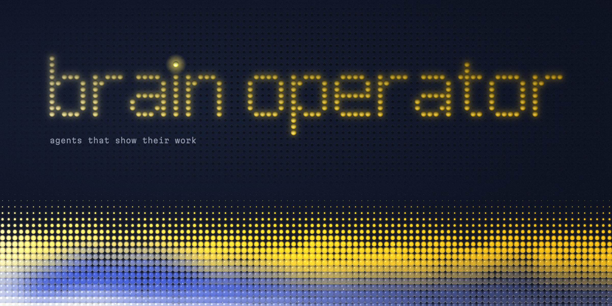

# Brain Operator

**Agents that show their work.**

Brain Operator runs Claude Code, Codex and Gemini over your repositories and Obsidian vaults, side by side, each thread in its own git worktree. Every run ends with a receipt: what the agent was allowed to see, what it searched, read and cited, and which citation points to nothing.

It drives the CLIs you are already logged into, so there are no API keys to store. The Workbench has no npm dependencies and loads nothing from a CDN.

> Technical preview · v0.9.0, *The Workbench*

## The receipt

Other tools return an answer. Brain Operator returns the answer and the evidence:

```
faithfulness  88/100  mostly grounded · 7 grounded, 0 cited-but-unread, 1 phantom
scope         80 of 1,716 notes in scope · 1,636 withheld
              (inactive project 783 · archive 539 · build output 308 · …)
catalog       80 notes, 80 included, 0 omitted
surfaced      3 ranked pointers, offered before the flat catalog
searched      4 Grep/Glob calls
read          12 files
cited         7 resolved [[wiki-links]]
missing       1 phantom reference
receipt       Markdown + JSON
```

Read it the way you read a stack trace. It catches what a chat window hides:

- a citation to a `[[Page]]` that does not exist
- a citation to a page the agent never opened in this run
- a broad search that read the wrong files
- archive and build output ranked alongside live notes
- a previous agent's handoff that contains instruction-like text
- a write about to run while unrelated files are already dirty
- a write that touched a file outside its declared allowlist

## Quickstart

Needs Node.js 18+ and at least one logged-in agent CLI: `claude`, `codex` or `gemini`. `--provider sim` runs without any of them.

```bash
# See which CLIs, repo and vault profile Brain Operator detects
node bin/brain-operator.js doctor

# Open the Workbench over a repo or vault, at 127.0.0.1:4141
node bin/brain-operator.js serve /path/to/repo-or-vault

# Or run one headless turn in an isolated worktree
node bin/brain-operator.js run "Audit retrieval scoping" --provider claude --worktree
```

`npm link` from a local clone gives you a global `brain-operator` command.

## The Workbench (v0.9.0)

- **Parallel threads.** `brain-operator serve` opens a three-pane local studio with streaming over Server-Sent Events, a `⌘K` palette, and fork, pin, archive and search.
- **Three agents, one thread.** Switch between Claude Code, Codex and Gemini mid-thread. Same-provider sessions resume natively (`--resume`, `codex exec resume`); crossing providers compiles a fenced, untrusted-data `brain-operator.thread-handoff` block.
- **A worktree per thread.** Threads write to `.brain-operator/worktrees/<slug>` on `bo/<slug>` branches. Review the diff, run the secret scan, commit, merge back or discard. Merge-back fails closed on a dirty base checkout and aborts cleanly on conflict.
- **Fleet and Observatory.** Every running thread and worktree in one view, with faithfulness over time per agent from `.brain-operator/runs.jsonl`.
- **CLI.** `serve`, `doctor`, `threads`, `worktrees`, and headless `run "<prompt>" --provider claude|codex|gemini --worktree`.
- **Obsidian bridge.** The Operator can resume any earlier thread and opens the Workbench from the Operator, Home, the command palette or `obsidian://brain-operator?mode=workbench`.

Older releases are in [CHANGELOG.md](./CHANGELOG.md).

## The Obsidian plugin

On first launch in an empty vault, the plugin offers to scaffold a governed brain: `CLAUDE.md`, `AGENTS.md`, a routing policy, `Current State.md` and a small sample wiki. It then operates that structure through the agent CLI you already run.

| Mode | What it does | Status |
|------|--------------|--------|
| **Operator** | The front door: what your vault calls live, your last thread, one input. | Shipped |
| **Ask** | Routing-aware questions with ranked pointers, the Answer Trace and receipt export. | Shipped |
| **Observatory** | Faithfulness over time, per-agent comparison, drift hotspots, run log. | Shipped |
| **Context Audit** | Read-only check for freshness, aperture, permissions and stale control-plane leaks. | Shipped |
| **Agent Pulse** | Recent Claude and Codex sessions, generated images, automations, git state. | Shipped, read-only |
| **GitHub Connect** | Guarded `git init`, private repo create or reuse, push. | Shipped |

Ship was removed in v0.8.0. Decide and File Back are under consideration, not promised.

### Install

1. Install [Obsidian](https://obsidian.md) and [Claude Code](https://claude.com/code), then run `claude login` once.
2. Copy this folder to `<your-vault>/.obsidian/plugins/brain-ask/`.
3. In Obsidian, go to Settings → Community plugins and enable **Brain Operator**.
4. In an empty vault, choose **Scaffold Brain** when asked. Review `CLAUDE.md` and `wiki/_common/context-routing.md`.
5. Open the **Operator** from the ribbon and ask something.

To read the starter files before installing, see [`examples/starter-vault/`](examples/starter-vault). A test keeps it identical to what the plugin writes.

## Safety

Brain Operator never rewrites your vault silently.

- Ask, Trace and the Operator are read-only. `--permission-mode plan` is enforced whatever the write setting says.
- Run history and continuity live in `.brain-operator/` at the vault root. Obsidian does not index it, and it is added to `.gitignore` because it holds real paths and queries.
- Context Audit is read-only. Apply is opt-in per finding and limited to an allowlist of target paths.
- Apply refuses to start if files outside its allowlist are already dirty, and every write run ends with `git diff --name-only HEAD`. A path outside the allowlist raises a warning before the run is marked complete.
- Handoffs between agents are injected only as fenced JSON labelled untrusted data.
- The default permission mode is `acceptEdits`. `bypassPermissions` is an advanced, private-only toggle, and a copied `data.json` that sets it without the private opt-in is reset on load.
- Agent Pulse, the Observatory and the scaffold make no model calls: they read the filesystem and `git`.

## Limits

- Each agent CLI must be installed and logged in locally.
- Three vault profiles are recognised: the Brain Operator scaffold, PARA and Zettelkasten. Code repositories run without vault exclusions, and the scope cell says so.
- The Workbench binds to `127.0.0.1`. There is no cloud sync and no multi-user mode.
- GitHub Connect needs `gh` to be authenticated first. No token is stored.

## How it works

```
Obsidian plugin
  ├─ vault profiles    ─→ folder patterns → roles (scaffold · PARA · Zettelkasten)
  ├─ catalog scope     ─→ profile exclusions + Current State active projects
  ├─ BootstrapModal    ─→ first-launch governed starter scaffold
  ├─ OperatorModal     ─→ front door: what's live, last thread, one input
  ├─ AskModal          ─→ spawns claude with context-routed preamble + tools
  ├─ Observatory       ─→ offline dashboard over .brain-operator/runs.jsonl
  ├─ EvolveModal       ─→ read-only context-governance audit
  ├─ GitHubConnect     ─→ local git init + gh repo create/reuse + private push
  ├─ AgentPulseModal   ─→ pure filesystem reads (Claude + Codex sessions, git, images)
  ├─ QuickModeModal    ─→ fuzzy mode dispatcher
  └─ BrainAskSettingTab — claude/codex paths, permission mode, audit pages

Workbench (bin/brain-operator.js serve)
  ├─ server.js         ─→ 127.0.0.1:4141, UI + Server-Sent Events
  ├─ engine.js         ─→ threads, turns, cross-provider handoffs
  ├─ providers.js      ─→ claude · codex · gemini · sim adapters
  ├─ worktrees.js      ─→ bo/* branches, diff, secret scan, merge-back
  └─ store.js          ─→ .brain-operator/ thread and run state

claude invocation:
  --print --output-format stream-json --verbose
  --include-partial-messages
  --permission-mode plan             [Ask/Context Audit/Apply-plan]
  --permission-mode acceptEdits      [Apply-execute only]
  --allowedTools Read,Grep,Glob      [read-only flows]
  --allowedTools Read,Edit           [Apply-execute only]
  --append-system-prompt "<vault conventions>"
  --session-id <uuid>  [or --resume <last>]
```

The agents' own tools do the retrieval. Brain Operator scopes the vault, injects the catalog and conventions, and watches the tool-use events to record what the agent actually did.

## The Answer Trace

Eight cells after every Ask:

- **faithfulness**: of every `[[link]]` in the answer, the share that resolved to a real note and was read in this run (0–100), with grounded, cited-but-unread and phantom counts
- **scope**: notes eligible for context out of the vault total, and why the rest were withheld
- **catalog**: in-scope notes, with included and omitted counts
- **surfaced**: pages offered as ranked pointers, with the reason
- **searched**: the actual `Grep` and `Glob` calls
- **read**: the files the agent opened
- **cited**: `[[wiki-links]]` that resolved to real notes
- **missing**: `[[wiki-links]]` that resolve to nothing

Each trace exports as Markdown, as JSON (`brain-operator.agent-trace@1`), or as a receipt (`brain-operator.agent-receipt@1`).

## The Observatory

A dashboard over your run history: a faithfulness dial, per-run trend, agent comparison, drift hotspots and a run log. It opens over `file://` with no server and makes no external requests. Every Ask appends to `.brain-operator/runs.jsonl`; until you have runs, it shows a sample set.

<details>
<summary><b>Surfaces, settings and vault conventions</b></summary>

### Surfaces

- **Ribbon**: opens the Operator
- **Command palette** (`Cmd+P`): every mode is a command
- **Quick dispatcher**: fuzzy mode picker; bind a hotkey to it
- **Status bar**: "brain · op", opens Home
- **Selected text**, right-click: "Ask about <selection>"
- **Any markdown note**, right-click: "Ask about [[note]]" and "Open Home"
- **URI**: `obsidian://brain-operator?mode=operator` (or `ask`, `evolve`, `pulse`, `github`, `home`, `workbench`)

### Settings

- **Claude CLI path** and **Codex CLI path**: detected on load, with Detect, Check auth and Version buttons
- **Permission mode**: `acceptEdits` (default), `plan`, `default`, or `bypassPermissions` (advanced, private only)
- **Allowed tools**: default `Read,Grep,Glob`
- **Model override**: blank uses your Claude Code default
- **MCP config path**: advanced; for `obsidian-local-rest-api` through `mcp-tools`
- **Ask**: retrieval depth, max note characters, catalog in prompt, catalog limit, surfaced-pointer limit, token streaming, tool events
- **Context Audit**: key policy pages to read first
- **Agent Pulse**: recent items per lane

### Conventions the system prompt enforces

- Wiki-links by basename: `[[Page Name]]`
- `01_Projects/` is action, `wiki/` is LLM-owned knowledge, `raw/` is immutable sources
- Frontmatter: `title`, `category`, `tags`, `sources`, `created`, `updated` (ISO 8601), `status`
- `active` binds; `historical` and `archived` are evidence; `scratch` and `speculative` never bind; a missing status does not prove freshness
- Only `wiki/operating/Current State.md` says what is live; folder membership does not
- Maintenance workflows run when you ask, never on a schedule
- No emoji in the wiki, no hype, no invented packages

</details>

## Tests

```bash
node tests/run-all.js
```

| Suite | Covers |
|---|---|
| `parser-tests.js` | parsers, schemas, routing, catalog scope, freshness weighting, plugin state, system prompt, multi-thread picker |
| `cold-install-sim.js` | first-launch scaffold on a temp vault, retired-system scan, examples parity |
| `apply-guard-e2e.js` | Apply dirty-worktree guard against real git |
| `observatory-smoke.js` | the dashboard on empty, real and malformed archives |
| `workbench-e2e.js` | provider adapters, parallel git worktrees, merge and conflict safety, live HTTP and SSE, UI offline contract |

v0.9.0 gate: parser 267/267, cold install 27/27, apply guard 6/6, observatory 19/19, workbench 52/52. 371/371 in total.

## Proof

Receipts, not launch claims:

- [v0.9.0 design spec](docs/superpowers/specs/2026-11-24-brain-operator-v0.9.0-workbench.md): architecture and safety invariants for the Workbench
- [v0.8.0 design spec](docs/superpowers/specs/2026-07-28-brain-operator-v0.8.0-design.md): the measurements behind vault-contract scoping, including two corrections the measurements forced
- [Obsidian runtime proof](docs/proofs/obsidian-runtime-v0.6.6.md): Obsidian loads `brain-ask` and registers its commands
- [Answer Trace example](docs/proofs/answer-trace-example.md): a run artifact with catalog, searched, read, cited and missing
- [Blocked Apply example](docs/proofs/safe-apply-blocked-example.md): what Brain Operator stops before a write

## Works alongside

- `obsidian-local-rest-api`, through `--mcp-config`, for MCP-based retrieval
- `mcp-tools`: Brain Operator handles scoping, tracing and the scaffold, not the vault API
- `obsidian-git` and `obsidian-excalidraw-plugin`; GitHub Connect prepares the remote that Obsidian Git syncs
- Any Claude Code skills you have installed

## Roadmap

- **v0.2** Ask, inline Answer Trace, CLI subprocess, session resume
- **v0.3** Codex detection, Agent Pulse, Evolve dry-run audit, safer default permission mode
- **v0.4** Structured Evolve contract and two-step Apply with a `target_paths` allowlist
- **v0.4.5** Ribbon, URI handler, context menus, status bar, Quick dispatcher
- **v0.5.0** First-launch scaffold: the plugin alone can create a brain
- **v0.5.7** Agent Handoff Log for cross-CLI continuity
- **v0.6.0** Trace and receipt schemas and exports, read-only Ask, fenced untrusted handoffs, catalog cap
- **v0.6.2** GitHub Connect
- **v0.6.5–0.6.6** Auth-probe hotfix and shell-safety hardening
- **v0.6.7** Context governance and Context Audit
- **v0.6.8** Proactive surfacing as ranked pointers
- **v0.6.9** Retrieval Faithfulness score: deterministic, local, no model call
- **v0.7.0** The Operator front door. The Observatory was announced here but never committed; it shipped in v0.8.0.
- **v0.8.0** Vault-contract scoping, `Current State` gate, freshness weighting, plugin state out of the wiki, the Observatory, generated example vault
- **v0.9.0** The Workbench: parallel threads, Claude, Codex and Gemini in one thread, worktrees with fail-closed merge-back, Fleet and live Observatory
- **Next** Configurable scope globs, pull requests from worktrees, a desktop wrapper and mobile companion
- **v1.0** Obsidian community plugin listing and npm release

## Brand

The identity lives in [`docs/brand/`](docs/brand): the banner, the social preview and the app icon. Midnight navy, and a plate of holes that open into yellow light like a halftone. The name is drawn on the same grid, and the only live dot is the one on the i.

## License

MIT.

## Credits

Built by Ege Deniz. The bundled `karpathy-guidelines` skill is MIT, inspired by [Andrej Karpathy's observations on LLM coding pitfalls](https://x.com/karpathy/status/2015883857489522876), packaged by [forrestchang](https://github.com/forrestchang/andrej-karpathy-skills).
