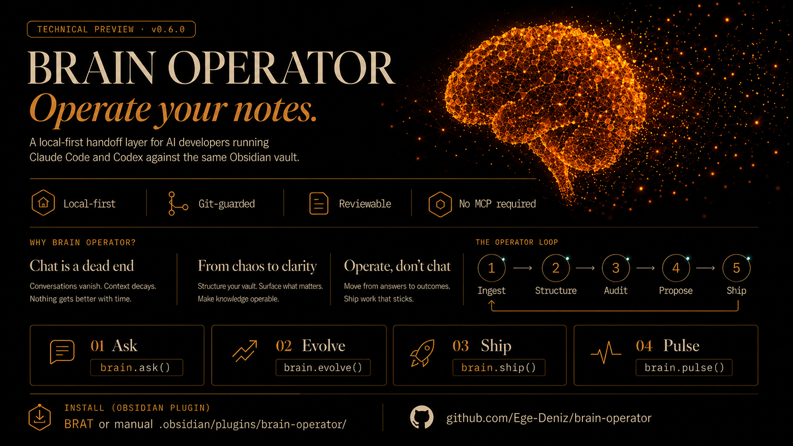

# Brain Operator

> **Status:** Technical Preview · v0.9.0 — *The Workbench*
>
> Local-first multi-agent Workbench and Obsidian DevTools for running **Claude Code**, **Codex CLI**, and **Gemini CLI** side by side over repositories and markdown vaults — with parallel threads, isolated git worktrees, vault-contract context scoping, deterministic Retrieval Faithfulness, live diff review, and a local Observatory.

Think **T3 Code + Orca**, built with **zero runtime dependencies**, **zero API keys** (your existing CLI subscriptions), and Brain Operator's inspectability wedge: every turn tells you what the agent searched, read, cited, missed, and changed.

## What's new in v0.9.0 — *The Workbench*

Brain Operator outgrew a single blocking Obsidian modal. v0.9.0 ships a standalone, zero-dependency local multi-agent Workbench alongside the upgraded Obsidian plugin:

- **Parallel multi-thread orchestration (`brain-operator serve`).** Run multiple threads simultaneously over any local git repository or Obsidian vault from a 3-pane local web studio (`127.0.0.1:4141`, Server-Sent Events streaming, `⌘K` command palette, fork/pin/archive/search). Zero npm dependencies, zero CDN requests.
- **Multi-provider CLI driving — Claude Code, Codex CLI, and Gemini CLI.** Codex is no longer "observed, not driven." Switch providers *mid-thread* at any time: Brain Operator natively resumes same-provider sessions (`--resume` / `codex exec resume`) and automatically compiles a fenced untrusted-data `brain-operator.thread-handoff` block when bridging across providers.
- **Isolated git worktrees per thread.** Spin up `.brain-operator/worktrees/<slug>` on `bo/<slug>` branches so multiple agents work in parallel without stepping on each other. Review colorized unified diffs, run secret-scan preflight, commit, safely merge back (fail-closed on dirty base checkout; automatic `git merge --abort` on conflict), or discard cleanly.
- **Agent Fleet & Live Observatory.** Monitor every running thread and worktree in one Fleet view, and chart faithfulness over time with a live Claude vs. Codex vs. Gemini leaderboard backed by the shared `.brain-operator/runs.jsonl` archive.
- **First-class CLI.** `brain-operator serve`, `brain-operator doctor`, `brain-operator threads`, `brain-operator worktrees`, and headless `brain-operator run "<prompt>" --provider claude|codex|gemini --worktree`.
- **Upgraded Obsidian plugin.** `OperatorModal` now ships a **multi-thread picker** that resumes any prior session (not just `lastSessionId`), plus one-click **Open Workbench ↗** from the Operator, Home, command palette, or `obsidian://brain-operator?mode=workbench`.

Older release notes live in [CHANGELOG.md](./CHANGELOG.md).

## Quickstart (Workbench CLI — 30 seconds)

Requires Node.js 18+ and at least one logged-in agent CLI (`claude`, `codex`, or `gemini`; includes a built-in `--provider sim` dry-run mode for testing).

```bash
# Inspect detected CLIs, git repo, and vault profile
node bin/brain-operator.js doctor

# Launch the local Workbench UI over any repo or Obsidian vault
node bin/brain-operator.js serve /path/to/your/repo-or-vault

# Or run a headless turn in an isolated git worktree
node bin/brain-operator.js run "Audit retrieval scoping" --provider claude --worktree
```

Or install globally from a local clone with `npm link` and run `brain-operator`.

## Technical Preview Scope

This is a live technical preview for developers already comfortable with local tools.

- Runs locally over any git repository or Obsidian markdown vault.
- Stores no Claude, OpenAI, Gemini, or GitHub credentials — drives the CLIs you already authenticate locally.
- Read-only Ask/Trace writes nothing to your knowledge layer; worktree edits stay isolated on `bo/*` branches until you review and merge; Obsidian Apply flows remain allowlisted and git-checked.
- Standalone Workbench requires Node 18+; Obsidian plugin tested on Obsidian 1.12.7.

Built for developers and AI builders who use Obsidian as a local agent workbench, not just a note archive.

## What it actually does

A fresh install in an empty vault → one click → working second brain. From scratch, in 60 seconds.

The plugin scaffolds a governed vault (routing policy, `CLAUDE.md`, `AGENTS.md`, sample pages) on first launch, then operates that structure via the agent CLI you already run. No API key. Your subscription, your vault, your subprocess.

## The wedge

Other Obsidian AI plugins return an answer. Brain Operator returns the answer plus the run artifact:

```
faithfulness: 88/100 (mostly grounded) — 7 grounded, 0 cited-but-unread, 1 phantom
scope:        80 in scope of 1716, 1636 withheld
              (inactive project 783 · archive 539 · build output 308 · …)
catalog:      80 notes, 80 included, 0 omitted
surfaced:     3 ranked pointers (offered before the flat catalog)
searched:     4 Grep/Glob calls
read:         12 files
cited:        7 resolved [[wiki-links]]
missing:      1 phantom reference
receipt:      Markdown + JSON
```

You can debug retrieval drift the way you debug code. The scope, missing-ref, and faithfulness cells are the product wedge.

## What this catches that normal AI chat misses

- The answer cited a `[[Page]]` that does not exist.
- The answer cited a page it never opened this run.
- The agent searched broadly but read the wrong files.
- Retrieval was ranking your archive and build output alongside live knowledge.
- A previous agent handoff contains hostile or instruction-like text.
- Apply would run while unrelated files are already dirty.
- Apply changed a file outside the declared target allowlist.
- A teammate needs the receipt, not a vague "Claude said it worked" summary.

## Modes

| Mode | What it does | Status |
|------|--------------|--------|
| **Operator** | The front door. Shows what your vault calls live, your last thread, and one input. Resume, or start fresh. | Shipped |
| **Ask** | Routing-aware Q&A that surfaces relevant pages as ranked pointers, with Answer Trace and Agent Receipt export | Shipped |
| **Observatory** | Local dashboard: faithfulness over time, per-agent comparison, drift hotspots, run log | Shipped |
| **Context Audit** | Read-only check for freshness, aperture, permission, and stale control-plane leaks | Shipped |
| **Agent Pulse** | Timeline of recent Claude + Codex sessions, generated images, automations, git state | Shipped; read-only |
| **GitHub Connect** | Guarded git init, private repo create/reuse, and push | Shipped |

**Removed in v0.8.0:** Ship. It had been paused since v0.6.7, and the governed vault contract lists it under "Removed Workflows". Deleting it matches the brain; rewriting it would re-import the cage.

**Roadmap (under consideration, not promised):** Decide (read/write Decision Log with flip criteria), File Back (file the current conversation as a wiki page, permission-gated). Both intentionally cut to keep the plugin honest about what works today.

## Install

### Prerequisites
- [Obsidian](https://obsidian.md) (free)
- [Claude Code](https://claude.com/code) installed and logged in: `npm i -g @anthropic-ai/claude-code` then `claude login`. One-time.

### Plugin install (3 minutes)
1. Drop this folder into `<your-vault>/.obsidian/plugins/brain-ask/`
2. Obsidian → Settings → Community plugins → enable **Brain Operator**
3. **First launch in an empty vault**: a modal asks *"Scaffold a Brain in this vault?"* → click **Scaffold Brain** → governed starter files are written: `CLAUDE.md`, `AGENTS.md`, `wiki/_common/context-routing.md`, `wiki/_common/wiki-workflows.md`, `wiki/_scratch/`, `Current State.md`, and a small sample wiki.
4. Open `CLAUDE.md` and `wiki/_common/context-routing.md` → review the operating contract.
5. Click the ribbon to open the **Operator** and ask something.

That's it. No separate repo to clone. No manual skill installation. No structure to learn before you can use it.

> To inspect the governed starter files before installing, browse [`examples/starter-vault/`](examples/starter-vault). It is generated from `getGovernedStarterVault()` by `tools/sync-starter-examples.js`, and a test asserts the two stay identical — so what you read there is exactly what gets written.

## Safety Model

Brain Operator never silently rewrites your vault.

- **Ask, Trace, and the Operator write nothing to your knowledge layer.** `--permission-mode plan` is enforced regardless of the write-mode setting.
- **Plugin state lives outside the wiki.** Continuity and run history go to `.brain-operator/` in the vault root — a dot-folder Obsidian does not index, so it never enters your catalog, graph, or search. Added to `.gitignore` automatically; it holds real vault paths and query text.
- **Context Audit** runs read-only and looks for stale authority, routing conflicts, and executable surfaces that bypass the policy. Apply remains opt-in per finding and target-path allowlisted.
- Apply refuses to start if `git diff --name-only HEAD` shows dirty files outside the Apply target allowlist.
- Every write run ends with `git diff --name-only HEAD`. If any newly modified path falls outside the declared allowlist, a red warning surfaces before the run is marked complete.
- Agent handoffs are injected only as fenced JSON explicitly labelled untrusted data. Aperture and Tradeoff prompts suppress them entirely.
- Default permission mode is `acceptEdits`, not `bypassPermissions`. Bypass is kept as an advanced toggle, labeled private-only. A copied `data.json` containing `bypassPermissions` without an explicit private opt-in is reset to `acceptEdits` on load.
- `data.json` is gitignored (contains binary paths + last session ID, never credentials).
- Agent Pulse, the Observatory, and the Bootstrap flow spawn no LLM call — pure filesystem and `git` reads.

The mental model: Claude Code has agency, but the plugin makes that agency **visible, scoped, and reversible**.

## Current Limitations

This is a Technical Preview. Honest about what's not done:

- **Provider CLIs require local installation and login.** Brain Operator drives `claude`, `codex`, and `gemini` via their official CLIs; whichever CLI you pick must be installed and logged in locally.
- **Three vault profiles, not every layout.** Brain Operator scaffold, PARA, and Zettelkasten are recognised. General code repositories run cleanly with no vault exclusions, reported honestly in the Context inspector and `scope` trace cell.
- **Localhost workbench, not hosted SaaS.** The Workbench server binds to `127.0.0.1` with zero cloud sync or multi-user collaboration.
- **GitHub auth is user-approved.** GitHub Connect automates repo creation and push after `gh` is authenticated, but the login itself requires you to approve GitHub OAuth/device auth. No token is stored.

## How it works

```
Obsidian plugin
  ├─ vault profiles    ─→ folder patterns → roles (scaffold · PARA · Zettelkasten)
  ├─ catalog scope     ─→ profile exclusions + Current State active projects
  ├─ BootstrapModal    ─→ first-launch governed starter scaffold
  ├─ OperatorModal     ─→ front door: what's live, last thread, one input
  ├─ AskModal          ─→ spawns claude with context-routed preamble + tools
  ├─ Observatory       ─→ offline dashboard over .brain-operator/runs.jsonl
  ├─ EvolveModal       ─→ read-only context-governance audit
  ├─ GitHubConnect     ─→ local git init + gh repo create/reuse + private push
  ├─ AgentPulseModal   ─→ pure filesystem reads (Claude + Codex sessions, git, images)
  ├─ QuickModeModal    ─→ fuzzy mode dispatcher
  └─ BrainAskSettingTab — claude/codex paths, permission mode, audit pages

vault-root state (gitignored, not indexed by Obsidian)
  .brain-operator/handoffs.jsonl   cross-CLI continuity
  .brain-operator/runs.jsonl       Observatory run archive
  .brain-operator/observatory.html generated dashboard

claude invocation:
  --print --output-format stream-json --verbose
  --include-partial-messages
  --permission-mode plan             [Ask/Context Audit/Apply-plan]
  --permission-mode acceptEdits      [Apply-execute only]
  --allowedTools Read,Grep,Glob      [read-only flows]
  --allowedTools Read,Edit           [Apply-execute only]
  --append-system-prompt "<vault conventions>"
  --session-id <uuid>  [or --resume <last>]

stream-json events → modal:
  • live tool stream (Read / Grep / Glob / Edit)
  • progressive answer (token deltas via --include-partial-messages)
  • Answer Trace panel after completion
  • Agent Receipt export as Markdown / JSON
```

No API key. Uses Claude Code's existing OAuth. Claude's native tools do retrieval — the plugin scopes and injects the vault catalog + conventions as a system prompt, and observes what Claude actually does via tool-use events.

## The Answer Trace

Eight cells shown after every Ask:

- **faithfulness** — the headline score (0–100): of every `[[link]]` the answer made, the share that resolved to a real note and was actually read this run, with grounded / cited-but-unread / phantom counts
- **scope** — how many notes were eligible for default context out of the vault total, and why the rest were withheld
- **catalog** — in-scope notes plus prompt-included / omitted counts
- **surfaced** — pages the operator proactively offered as ranked pointers, with the match reason (clickable → opens the note)
- **searched** — actual `Grep` / `Glob` calls with their query strings
- **read** — files Claude actually opened (clickable → opens the note)
- **cited** — `[[wiki-links]]` in the answer that resolved to real notes
- **missing refs** — `[[wiki-links]]` that don't resolve (typos, or proposed stubs)

Each trace has three export actions: **Export Trace as Markdown**, **Export Trace as JSON** (`brain-operator.agent-trace@1`), and **Copy Agent Receipt** (`brain-operator.agent-receipt@1`).

## The Observatory

A local-first dashboard over your run history. Faithfulness dial, per-run trend, Claude vs Codex comparison, drift hotspots (pages cited but unread, and links that resolve to nothing), and a run log.

Self-contained: it opens over `file://` with no server and makes zero external requests. Every Ask appends its trace to `.brain-operator/runs.jsonl`; the dashboard inlines your real runs at open time and falls back to a sample set until you have run one.

## Surfaces (where you invoke modes)

- **Ribbon** (left rail) — brain-circuit icon → **Operator**
- **Command palette** (`Cmd+P`) — every mode registered as a command
- **Quick dispatcher** — fuzzy mode picker; bind a hotkey for fastest access
- **Status bar** — "brain · op" entry, click → Home
- **Right-click selected text** → "Ask about <selection>" pre-fills AskModal
- **Right-click any markdown note** → "Ask about [[note]]" + "Open Home"
- **URI handler** — `obsidian://brain-operator?mode=operator` (or ask / evolve / pulse / github / home)

## Settings reference

**Core**
- **Claude CLI path** — auto-detected on load; **Detect** + **Check auth** buttons
- **Codex CLI path** — auto-detected on load; **Detect** + **Version** buttons
- **Permission mode** — `acceptEdits` (default), `plan`, `default`, or `bypassPermissions` (advanced / private only)
- **Allowed tools** — comma-separated. Default `Read,Grep,Glob`.
- **Model override** — blank uses your Claude Code default
- **MCP config path** — advanced; wire to `obsidian-local-rest-api` via `mcp-tools`

**Ask**
- Retrieval depth, max note chars, include catalog in prompt, catalog prompt limit, surfaced-pointer limit, stream token deltas, show tool events.

**Context Audit**
- Key policy pages — comma-separated vault-relative paths the audit reads first.

**Agent Pulse**
- Recent items per lane.

## Brain conventions enforced via system prompt

- Wiki-links basename-only: `[[Page Name]]`
- PARA split: `01_Projects/` = action, `wiki/` = LLM-owned knowledge, `raw/` = immutable sources
- Frontmatter: `title`, `category` (one of career / projects / education / life / finance / operating / concepts), `tags` (lowercase-hyphenated), `sources`, `created`, `updated` (ISO 8601), `status`
- Status vocabulary: `active` binds; `historical` / `archived` are evidence; `scratch` / `speculative` are never binding; a missing status does not prove freshness
- Only `wiki/operating/Current State.md` says what is live — folder membership does not
- Maintenance workflows (Query / Ingest / Lint / File Back) are user-invoked and never scheduled
- Hard bans: no emoji in wiki, no cringe/hype, no hallucinated packages, direct professional tone

## Tests

```bash
node tests/run-all.js
```

| Suite | Covers |
|---|---|
| `parser-tests.js` | parsers, schemas, routing, catalog scope, freshness weighting, plugin state, system prompt, multi-thread picker |
| `cold-install-sim.js` | first-launch scaffold on a temp vault, retired-system scan, examples parity |
| `apply-guard-e2e.js` | Apply dirty-worktree guard against real git |
| `observatory-smoke.js` | the dashboard renders on empty, real, and malformed archives |
| `workbench-e2e.js` | multi-provider adapters, real parallel git worktrees, merge/conflict safety, live HTTP + SSE server, UI offline contract |

Verification gate for v0.9.0: parser **267/267**, cold-install **27/27**, apply-guard e2e **6/6**, observatory smoke **19/19**, workbench e2e **52/52** (**371/371** total).

## Proof Artifacts

Small, inspectable receipts rather than launch claims:

- [v0.9.0 design spec](docs/superpowers/specs/2026-11-24-brain-operator-v0.9.0-workbench.md) — architecture and safety invariants for the multi-agent Workbench.
- [v0.8.0 design spec](docs/superpowers/specs/2026-07-28-brain-operator-v0.8.0-design.md) — the measurements behind vault-contract scoping, including two corrections that measurement forced.
- [Obsidian runtime load proof](docs/proofs/obsidian-runtime-v0.6.6.md) — Obsidian sees `brain-ask`, loads it, and registers its commands.
- [Answer Trace example](docs/proofs/answer-trace-example.md) — sample run artifact showing catalog, searched/read/cited/missing.
- [Safe Apply blocked example](docs/proofs/safe-apply-blocked-example.md) — what Brain Operator catches before a write flow proceeds.

## Coexists with

- `obsidian-local-rest-api` — consumable via `--mcp-config` for MCP-based retrieval (advanced)
- `mcp-tools` — Brain Operator handles **prompt scoping + trace + bootstrap**, not vault API
- `obsidian-git`, `obsidian-excalidraw-plugin` — no conflict; GitHub Connect prepares the underlying git remote that Obsidian Git can later sync
- Any Claude Code skills you have installed locally

## Roadmap

- **v0.2** ✅ Ask + inline Answer Trace + CLI subprocess + session resume
- **v0.3** ✅ Codex detection, Agent Pulse timeline, Evolve dry-run audit, safer default permission mode
- **v0.4** ✅ Structured Evolve JSON contract + two-step Apply with `target_paths` allowlist enforcement
- **v0.4.5** ✅ Single ribbon, URI handler, right-click menus, file menu, status bar, Quick dispatcher
- **v0.5.0** ✅ **BootstrapModal** — first-launch scaffold. Plugin alone is enough to create a brain.
- **v0.5.7** ✅ **Agent Handoff Log** — structured cross-CLI continuity
- **v0.6.0** ✅ AgentTrace / AgentReceipt schemas, trace exports, Ask forced read-only, fenced untrusted handoff context, catalog prompt cap
- **v0.6.2** ✅ GitHub Connect — guarded git init, private repo create/reuse, push
- **v0.6.5–0.6.6** ✅ Auth-probe hotfix, shell-safety hardening, `<finding>` fence breakout closed, stdin EPIPE, cancel interval leak
- **v0.6.7** ✅ Context-governance pass — route classification, catalog suppression for ideation/tradeoff, Context Audit
- **v0.6.8** ✅ Proactive surfacing — local relevance ranking offered as cited pointers
- **v0.6.9** ✅ Retrieval Faithfulness Score — deterministic, local, no-LLM
- **v0.7.0** ✅ Operator front door · ⚠️ Observatory was announced but never committed; shipped in v0.8.0
- **v0.8.0** ✅ Vault-contract retrieval scoping, `Current State` active-project gate, freshness weighting, plugin state out of the wiki, Observatory shipped for real, Ship and the retired-skill scaffold deleted, generated example vault
- **v0.9.0** ✅ **The Workbench** — standalone local multi-agent orchestration studio (`brain-operator serve` + CLI), parallel threads with SSE streaming, native Claude + Codex + Gemini CLI driving, mid-thread provider switching with fenced handoffs, isolated git worktrees with diff review and fail-closed merge-back, Fleet & live Observatory views, plus multi-thread picker and Workbench bridge in Obsidian
- **next** Configurable scope globs, PR creation/review from worktrees, desktop wrapper / mobile companion, README screenshots
- **v1.0** Polish + Obsidian community plugin marketplace & npm publication

## License

MIT.

## Credits

Built by Ege Deniz. The bundled `karpathy-guidelines` skill is MIT, inspired by [Andrej Karpathy's observations on LLM coding pitfalls](https://x.com/karpathy/status/2015883857489522876), packaged by [forrestchang](https://github.com/forrestchang/andrej-karpathy-skills).

If you ship a brain that compounds, post about it. The architecture only proves out at scale if multiple brains run on it.
